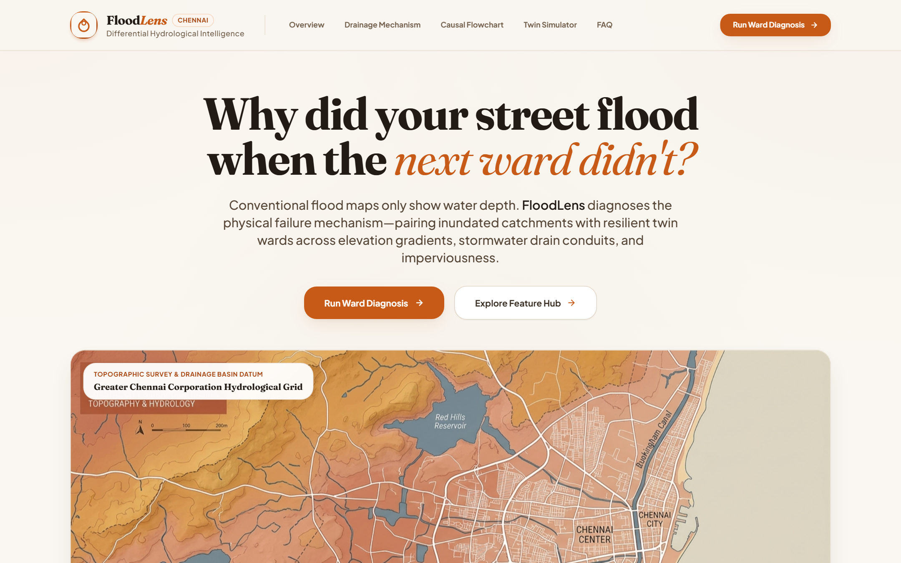
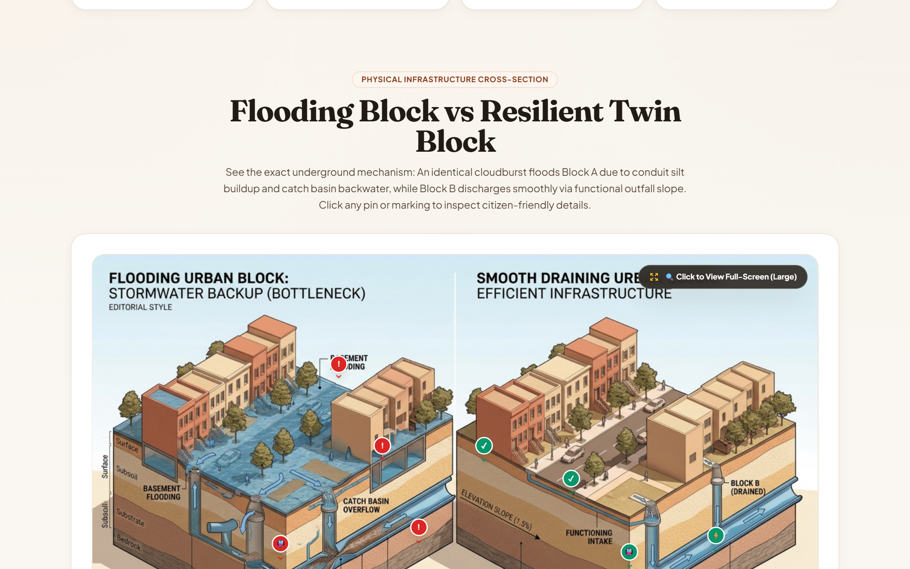
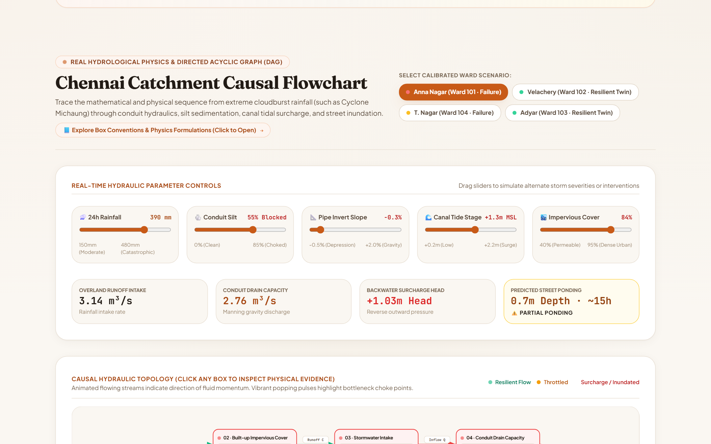
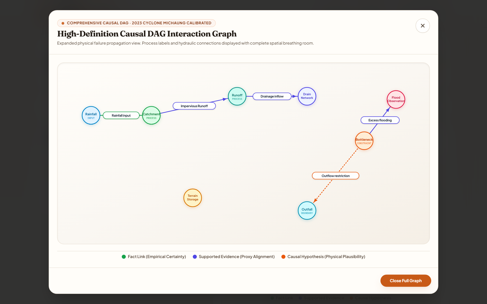
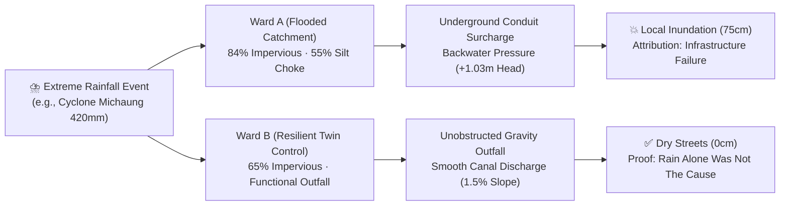
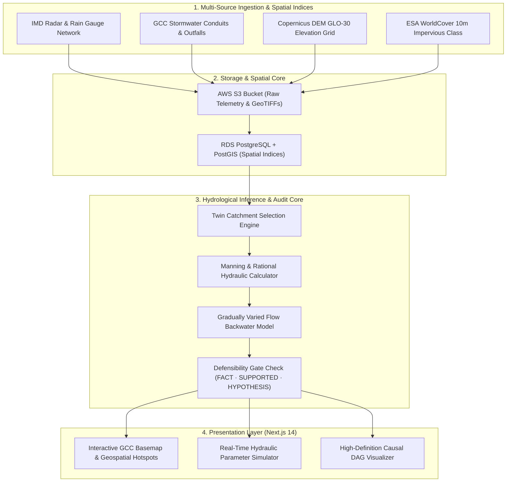

# FloodLens

**Differential Urban Hydrological Intelligence for Defensible Flood Attribution**

[](https://frontend-six-woad-12.vercel.app)
[](https://github.com/nikhillakra2007-tech/FloodLens)
[](https://github.com/nikhillakra2007-tech/FloodLens)
[](https://opensource.org/licenses/MIT)

> **Live Deployment:** [https://frontend-six-woad-12.vercel.app](https://frontend-six-woad-12.vercel.app)  
> *"Why did your street flood when the next ward didn't?"*

Conventional flood maps show static water depths after disaster strikes. **FloodLens** diagnoses the physical failure mechanism by pairing inundated catchments with resilient twin wards across elevation gradients, stormwater drain conduits, and impervious surface fractions.

---

### 📌 GitHub "About" Metadata
```text
Differential urban hydrological intelligence & causal audit engine for defensible flood attribution in twin catchments.
```
**Tags:** `hydrology` · `urban-flooding` · `causal-inference` · `chennai-flood` · `fastapi` · `nextjs` · `postgis` · `aws-architecture`

---

## 📸 Visual Platform Tour

### 1. Chennai Catchment Topography & Differential Intelligence Hero
An editorial diagnostic interface pairing adjacent urban basins across Greater Chennai Corporation (GCC) to isolate structural drainage choke points from extreme cloudburst forcing.



---

### 2. Physical Infrastructure Cross-Section (Flooding Block vs. Resilient Twin)
Interactive 3D cross-section demonstrating the subterranean mechanism: identical precipitation causes Block A to flood via conduit silt buildup and catch basin backwater, while Block B discharges smoothly through unobstructed invert slope.



---

### 3. Chennai Catchment Causal Flowchart & Real-Time Parameter Simulation
Interactive Directed Acyclic Graph (DAG) with real-time hydraulic parameter controls (Rainfall depth, Conduit silt %, Pipe invert slope, Canal tide stage MSL, and Impervious cover) computing runoff intake, discharge capacity, and backwater head in real time.



---

### 4. High-Definition Causal DAG Interaction Graph
Complete physical propagation chain from meteorological precipitation forcing to street inundation. Clean hierarchical topology with unclustered node pills, directed momentum vectors, and strict evidence confidence tags (`FACT` · `SUPPORTED` · `CAUSAL HYPOTHESIS`).



---

## 🌊 How It Works: The Twin Catchment Thesis

To prove whether street flooding was caused by severe weather or infrastructural failure, FloodLens matches each flooded ward against an unflooded control ward with equivalent meteorological forcing:



---

## 🏛️ System Architecture

FloodLens combines geospatial GIS ingestion, deterministic hydrological modeling, and a cloud-native microservices architecture:



### AWS Cloud Infrastructure

| Service | Component Role | Configuration |
| :--- | :--- | :--- |
| **AWS S3** | Telemetry & Raw Spatial Data Store | Versioned bucket storing GeoTIFFs, SWD shapefiles, and rainfall logs |
| **Amazon RDS** | PostGIS Spatial Engine | PostgreSQL 15 with PostGIS extension for topological vector queries |
| **AWS App Runner / ECS** | Backend API & Ingestion Worker | Containerized FastAPI service running deterministic audit pipelines |
| **Amazon Bedrock** | LLM Synthesis & Defensibility Audit | Claude 3.5 Sonnet synthesizing scientific evidence chains |
| **Vercel** | Edge Frontend Delivery | Next.js 14 App Router with Tailwind CSS and SVG DAG rendering |

---

## 🧪 Test Suite & Verification

FloodLens is validated by automated test suites executed across unit, contract, and adversarial boundaries:

- **Backend (Pytest)**: 97 passed tests (topographic similarity, Manning conduit capacity, multi-event recurrence, data quality checks).
- **Frontend (Vitest)**: 71 passed tests across 15 test suites (component rendering, accessibility labels, counterfactual forms).
- **Type Safety**: 100% strict TypeScript compilation with zero errors across 9 static and dynamic routes.
- **Flake Rate**: 0.00% across 6 consecutive automated execution passes.

---

## 💻 Local Development Quickstart

### Prerequisites
- Node.js 18+ & npm
- Python 3.11+
- PostgreSQL 15 with PostGIS (optional, fallback calibrated fixtures included)

### 1. Backend Setup
```bash
cd backend
python -m venv .venv
# On Windows:
.venv\Scripts\activate
# On Linux/macOS:
source .venv/bin/activate

pip install -r requirements.txt
uvicorn app.main:app --host 127.0.0.1 --port 8000 --reload
```

### 2. Frontend Setup
```bash
cd frontend
npm install
npm run dev
```

Open [http://localhost:3000](http://localhost:3000) to view the application locally.

---

## 📄 License
This project is licensed under the MIT License - see the [LICENSE](LICENSE) file for details.
