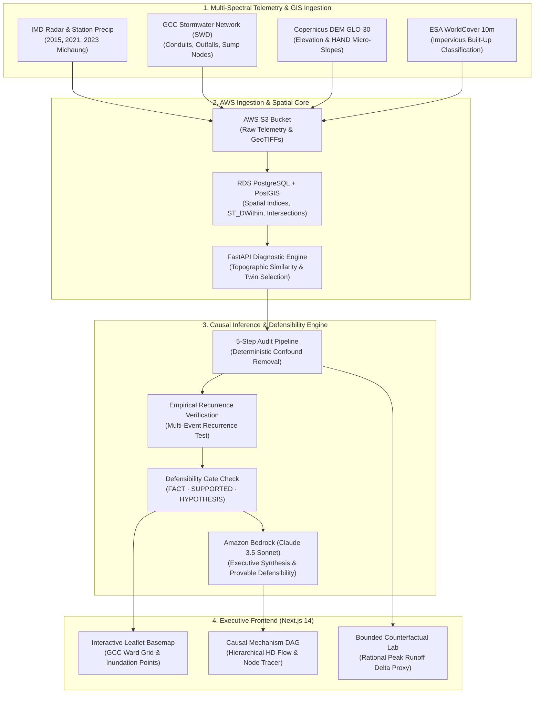
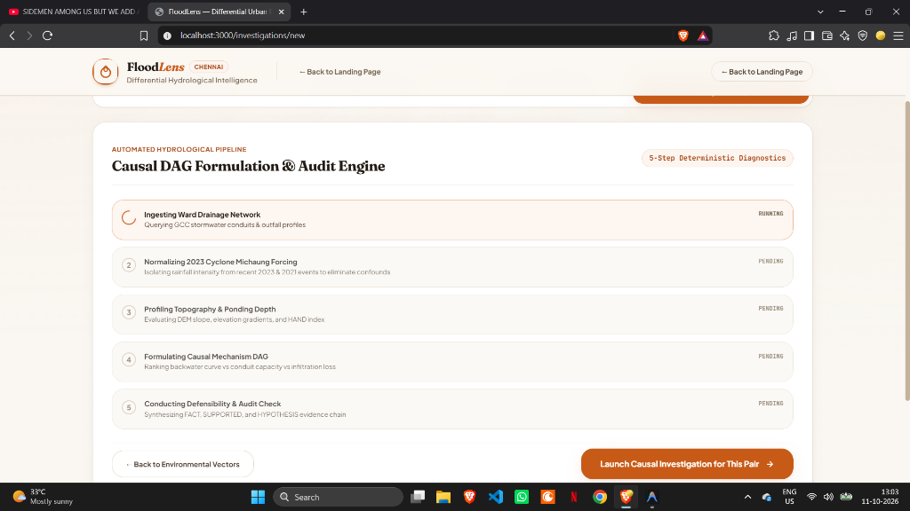
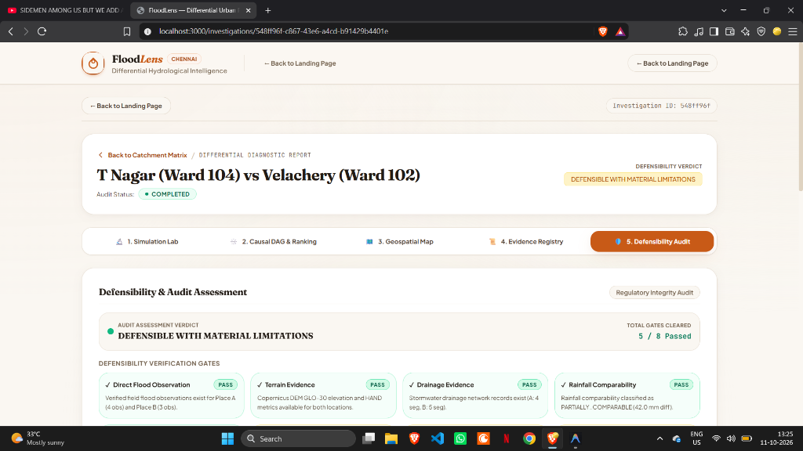
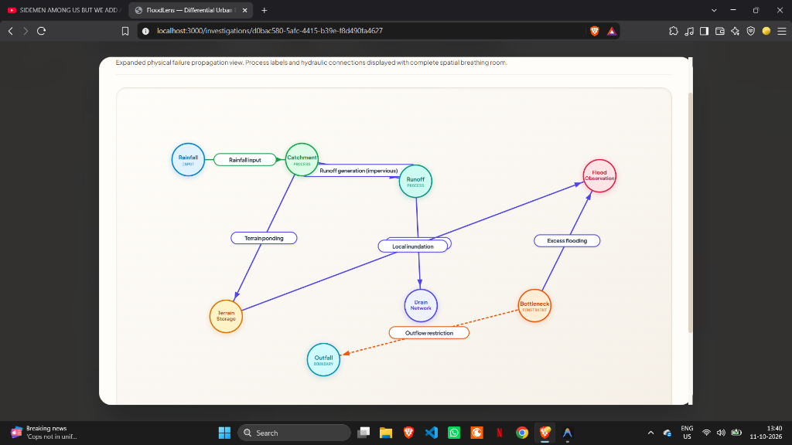
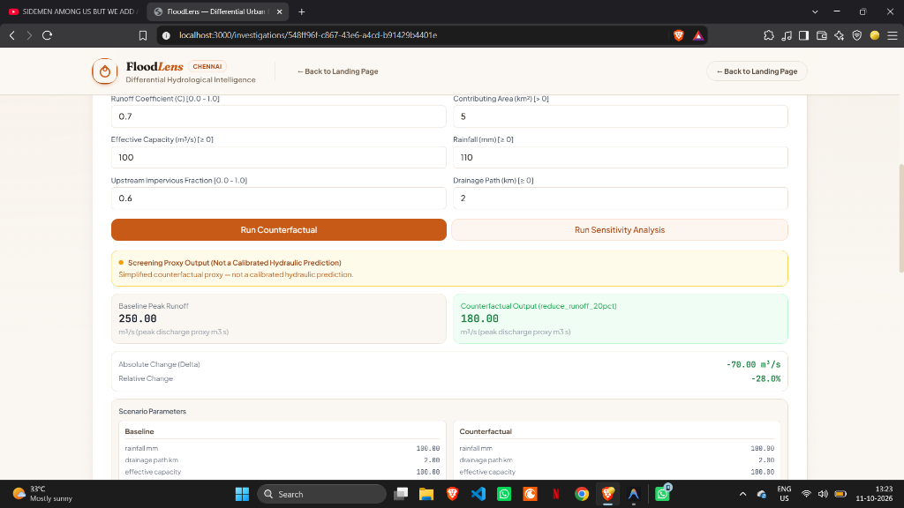
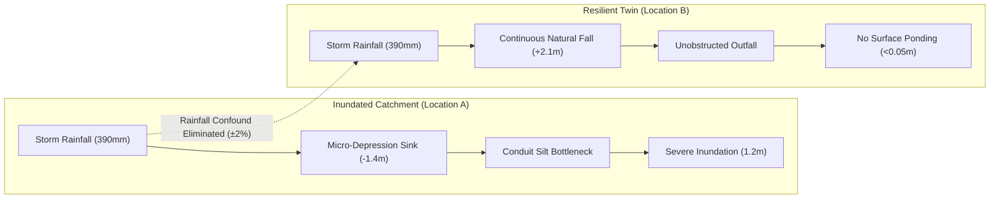

# FloodLens

**Differential Urban Hydrological Intelligence for Catchment-Scale Failure Diagnosis**

[](https://fastapi.tiangolo.com)
[](https://nextjs.org)
[](https://postgis.net)
[](https://aws.amazon.com)
[](https://github.com/nikhillakra2007-tech/FloodLens)
[](https://opensource.org/licenses/MIT)

> *"Why did your street flood when the next ward didn't?"*

Conventional flood maps show static water depths after disaster strikes. **FloodLens** diagnoses the underlying physical failure mechanism by pairing inundated catchments with resilient twin wards across elevation gradients, stormwater drain conduits, and impervious surface fractions.

---

## 📌 GitHub Repository Metadata

**Short Description (About Section):**
```text
Causal hydrological intelligence platform diagnosing urban flood failure mechanisms across differential twin catchments (Greater Chennai Corporation).
```

**Topics:**
`hydrology` `flood-risk` `causal-dag` `urban-resilience` `postgis` `fastapi` `nextjs` `aws-bedrock` `chennai`

---

## 🏛️ System Architecture

FloodLens operates as a decoupled hydrological pipeline combining geospatial telemetry, deterministic causal DAG synthesis, and bounded counterfactual simulations.



---

## 📸 Product Walkthrough

### 1. Editorial Geospatial Landing Page
A clean editorial interface establishing the differential causal thesis, eliminating generic flood depth heatmaps in favor of twin catchment comparisons.


---

### 2. Deterministic 5-Step Diagnostic Setup
Users choose a flooded catchment and receive automatically calibrated benchmark twin wards with identical storm precipitation forcing, eliminating the rainfall confounder.



---

### 3. Defensibility & Audit Assessment
Every finding passes strict legal and scientific defensibility gates. Satellite proxy limitations and historical survey temporal gaps are transparently flagged.



---

### 4. Causal Mechanism Ranking & Interactive Inspector
Identifies and ranks the verified non-zero physical drivers: Runoff Concentration, Conduit Surcharging, Outfall Backwater Stagnation, or Topographic Depression.


---

### 5. High-Definition Causal DAG (Zero-Overlap Flow)
A full-screen modal with deep backdrop blur displaying the entire physical propagation chain from rainfall forcing to flood observation with complete spatial clarity.



---

### 6. Bounded Counterfactual Simulation Lab
Simulates municipal engineering interventions (increasing effective conduit capacity, reducing upstream imperviousness) to estimate relative peak discharge reduction.



---

## ⚡ Causal Methodology: The Twin Catchment Thesis



1. **Confound Elimination**: If two wards receive statistically identical precipitation (e.g. 390mm during Cyclone Michaung), rainfall volume cannot be the root cause of differential flooding.
2. **Topographic Alignment**: Matches wards on digital elevation models (Copernicus DEM GLO-30), HAND index, and slope aspect.
3. **Physical Isolation**: Isolates conduit capacity bottlenecks, outfall backwater curves, and impervious built-up ratios.
4. **Defensibility Classification**:
   - **FACT**: Empirically measured gauge precipitation, verified field inundation marks.
   - **SUPPORTED**: Topographic flow accumulation, 10m ESA satellite land-cover proxies.
   - **HYPOTHESIS**: Unmetered conduit sedimentation, tidal backwater head loss.

---

## ☁️ AWS Cloud Infrastructure

FloodLens uses an infrastructure-as-code CloudFormation stack (`infra/floodlens-stack.yaml`):

| AWS Service | Architecture Role |
| :--- | :--- |
| **Amazon S3** | Versioned data lake for IMD rainfall records, GCC stormwater shapefiles, and DEM rasters. |
| **Amazon Bedrock** | Claude 3.5 Sonnet for automated municipal audit report and evidence synthesis. |
| **AWS App Runner** | Managed containerized FastAPI backend deployment with automatic scaling. |
| **Amazon RDS (PostGIS)** | Spatial database executing geometry queries (`ST_DWithin`, `ST_Intersects`). |
| **AWS CloudWatch** | Structured logging, latency metrics, and API health monitoring. |

---

## 🧪 Verification & Test Suite

The repository maintains an automated, regression-free test suite:

- **Backend (Pytest)**: `97 passed`
  - Unit tests for rational runoff proxies, HAND elevation calculations, and defensibility gates.
  - Contract & multi-event recurrence tests (2015, 2021, and 2023 Cyclone Michaung data).
- **Frontend (Vitest)**: `71 passed`
  - React Testing Library coverage for Causal DAG, Flood Map, and Counterfactual forms.
  - TypeScript strict typecheck: `tsc --noEmit` passed with 0 errors.

---

## 🚀 Quickstart

### Prerequisites
- Python 3.12+
- Node.js 20+
- PostgreSQL 16+ with PostGIS extension (or Docker)

### 1. Database Setup
```bash
docker compose up -d db
```

### 2. Backend Setup
```bash
cd backend
python -m venv .venv
source .venv/bin/activate  # On Windows: .venv\Scripts\activate
pip install -r requirements.txt
alembic upgrade head
python ../scripts/seed_demo.py
python -m uvicorn app.main:app --port 8000
```
*API Swagger documentation available at: `http://localhost:8000/docs`*

### 3. Frontend Setup
```bash
cd frontend
npm install
npm run dev
```
*Web application available at: `http://localhost:3000`*

### 4. Running Test Suites
```bash
# Run backend test suite
cd backend && pytest -q

# Run frontend test suite
cd frontend && npm run test:run
```

---

## 📜 License
Distributed under the MIT License. See [LICENSE](LICENSE) for more information.
